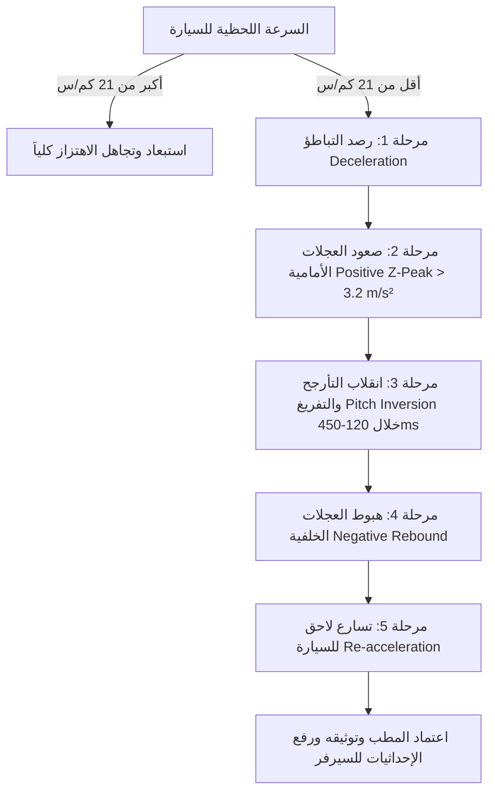

# وثيقة المواصفات الهندسية الشاملة: نظام رصد وتحذير المطبات الذكي
## (Intelligent Road Hazard & Speed Bump Telemetry Architecture)
**الإصدار:** 1.0 — **تاريخ التوثيق:** 2026-10-26  
**المشروع:** DriveCare Automotive Intelligence Engine  
**الفرع البرمجي:** `feature/road-guardian-bumps-integration`  
**النسخة المستقرة المعزولة:** Git Tag `v1.2-stable-clean` | أرشيف: `DriveCare_Backup_v1.2_Stable_20261026.zip`

---

## 1. الفلسفة المعمارية ومبادئ التصميم (Architecture Principles)
1. **خفة الأداء المطلقة (Zero Bloat & Lightweight Execution):**
   - لا تحميل لقواعد بيانات ضخمة ترهق ذاكرة الهاتف (RAM < 5MB).
   - لا استهلاك للبطارية عبر تشغيل خوارزميات مستمرة على المعالج المركزي؛ الاستفادة من Hardware Sensor Hub و Geofencing.
2. **السيرفر المركزي أولاً (Server-First Storage):**
   - السيرفر يحفظ كامل شبكة المطبات، والموبايل يستقبل فقط نافذة جغرافية ديناميكية دائرية (نطاق 20 كم) تتغير تلقائياً مع حركة السيارة.
3. **انعدام الإنذارات الكاذبة (Zero False Positives):**
   - الاعتماد على بصمة حركية خماسية صارمة لا تقبل الخطأ (السرعة < 21 كم/س + تباطؤ + صعود + انقلاب تأرجحي + نزول + تسارع لاحق).
4. **التكامل والتفرد عبر كمبيوتر السيارة (OBD-II Synergy):**
   - استخدام سرعة العجلات الحقيقية من كمبيوتر المحرك ECU للتأكد من ثبات الموبايل ومطابقة السرعة بدلاً من الاعتماد المنفرد على GPS.
5. **الفصل الصارم لقنوات العتاد (Hardware Separation):**
   - قراءة OBD-II عبر قناة البلوتوث المستقلة.
   - كاشف المطبات والتحذير الصوتي عبر حساسات الهاتف الداخلية (GPS + Accelerometer + Audio).
   - عدم وجود أي تعارض في الخيوط البرمجية (Independent Threads).

---

## 2. النمط الحركي الصارم للمطب (Kinematic Bump Signature)
لا يُسجل أي مطب جديد في النظام إلا بعد استيفاء الشروط التالية بالترتيب الزمني الدقيق:

### القواعد الحسابية (Mathematical Equations):
1. **بوابة السرعة:**
   $$V_{vehicle} \le 21.0 \text{ km/h} \quad (5.83 \text{ m/s})$$
2. **التسارع الرأسي الصافي (Linear Vertical Acceleration):**
   $$a_z = a_{raw\_z} - g_{gravity}$$
   حيث يُشترط قمة موجبة:
   $$a_{z\_max} \ge +3.2 \text{ m/s}^2$$
   تليها قمة سالبة:
   $$a_{z\_min} \le -2.5 \text{ m/s}^2$$
   وفارق القمتين:
   $$\Delta a_{p2p} = a_{z\_max} - a_{z\_min} \ge 5.7 \text{ m/s}^2$$
3. **الفاصل الزمني بين العجلات:**
   $$120 \text{ ms} \le \Delta t_{peaks} \le 450 \text{ ms}$$

---

## 3. فلترة اهتزاز اليد (Hand-Held vs Docked Phone Filter)
للتأكد من أن الموبايل مثبت في حامل السيارة (Rigid Car Dock) وليس في يد أحد الركاب:
1. **مقارنة متجهات السرعة:**
   $$|\vec{V}_{OBD} - \vec{V}_{GPS}| \le 2.0 \text{ km/h}$$
   إذا زاد الفارق أو حدث دوران سريع للهاتف حول محور $Y$ أو $Z$ بمعدل:
   $$\omega_{gyro} > 1.2 \text{ rad/s}$$
   يتم وسم القراءة بـ `HAND_HELD_SUSPECTED` وتعليق تسجيل أي مطب جديد فوراً، مع الإبقاء على التحذيرات الصوتية للمطبات السابقة.

---

## 4. مطابقة الخرائط والتفريق بين المسارات (Map Matching & Direction)
1. **زاوية الاتجاه (Bearing Differential):**
   يُخزن المطب مع زاوية متجه الطريق الأصلية: $\theta_{hazard} \in [0, 360^\circ)$.
   عند اقتراب السيارة بزاوية سير $\theta_{car}$، يُحسب الفرق الزاوي:
   $$\Delta \theta = \min(|\theta_{car} - \theta_{hazard}|, 360^\circ - |\theta_{car} - \theta_{hazard}|)$$
   - إذا كان $\Delta \theta \le 45^\circ$: **المطب في نفس المسار -> إطلاق التحذير الصوتي فوراً.**
   - إذا كان $\Delta \theta > 90^\circ$: **السيارة في الاتجاه المعاكس -> كتم وتجاهل التحذير كلياً.**
2. **طريق رئيسي vs طريق خدمة (Highway vs Service Road):**
   - المطابقة بالسرعة المتوسطة للقطاع (طريق رئيسي $\ge 90\text{ km/h}$ vs طريق خدمة $\le 60\text{ km/h}$).
   - استخدام مصفوفة الإسقاط العرضي `Cross-Track Distance` مع الخطوط الهندسية للطرق المعتمدة.

---

## 5. معمارية الكاش الديناميكي على السيرفر والموبايل (20km Dynamic Tile Cache)
1. **قاعدة بيانات السيرفر (`server.py` + `car_health.db`):**
   - حفظ الـ 4,380 مطباً المعتمدة مسبقاً من RoadGuardian في جدول مركزي `speed_bumps`.
   - نقطة اتصال جغرافية سريعة:
     `GET /api/hazards/nearby?lat={lat}&lng={lng}&radius_km=20`
   - نقطة تسجيل مطب جديد مؤكد:
     `POST /api/hazards`
2. **تطبيق الموبايل (Android Client):**
   - يحتفظ في الذاكرة بجدول مؤقت محلي لنطاق الـ 20 كم فقط.
   - عند تحرك السيارة لمسافة تزيد عن 5 كم بعيداً عن مركز النطاق، يُرسل التطبيق طلباً في الخلفية لجلب النطاق الجديد ومسح النقاط التي خرجت خارج الـ 20 كم.
   - تخزين محلي كامل (Offline Capable) لا يحتاج إنترنت أثناء القيادة طالما تم تحميل النطاق مسبقاً.

---

## 6. نظام التحذير الصوتي وزر الكتم (Audio Cues & Instant Mute)
- **مرحلتان للإنذار:**
  1. **إنذار مبكر (100 متر):** نغمة هادئة أو جملة مقتضبة: *"انتبه، مطب بعد 100 متر"*.
  2. **تنبيه نهائي (20 متراً):** نغمة مزدوجة سريعة في حالة استمرار السرعة العالية.
- **زر كتم فوري (Mute Toggle):**
  - زر عائم على شاشة القيادة: `[ 🔔 تحذير المطبات: مفعل ]` <-> `[ 🔇 صامت ]`.
  - كتم فوري بلمسة واحدة يوقف الصوت للرحلة الحالية دون إيقاف الرصد أو الحسابات في الخلفية.

---

## 7. الأفكار الابتكارية المضافة (Engineered Enhancements)
1. **تصنيف شدة المطب (Severity Index):**
   - مطب ناعم (Smooth) مقابل مطب حاد وخشن (Aggressive / Suspension-Damaging).
2. **مؤشر إجهاد عفشة السيارة (Suspension Wear Counter):**
   - تسجيل الصدمات العنيفة لكل سيارة في شاشة المالك لتنبيهه في جدول الصيانة بضرورة فحص المساعدين والبيض والمقصات.
3. **نظام التوثيق المجتمعي التراكمي (Crowd-sourced Consensus):**
   - مطب رصده سائق واحد = يظهر كـ (مطب تجريبي قيد التوثيق).
   - مطب أكده 3 سائقين = يُعتمد نهائياً في قاعدة البيانات ويُعمم للجميع.
